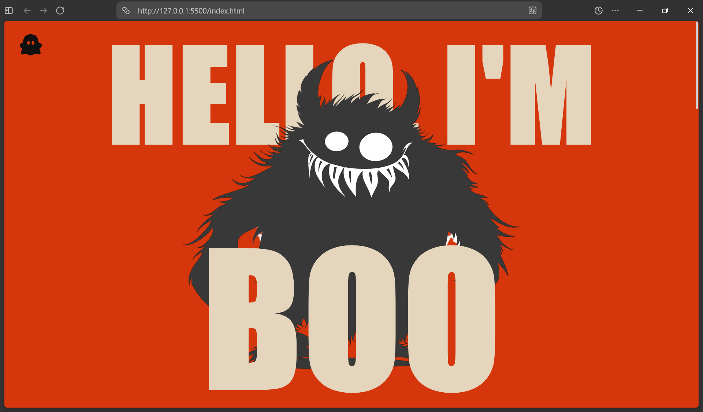

# Ghost Portfolio
portfolio website for a monster

Demo Link: [https://strawberryskeleton.github.io/ghost-portfolio/](https://strawberryskeleton.github.io/ghost-portfolio/)

## Features

#### Already added
- multiple sections
- fully designed by me
- experimented with a new hero section layout (i like it)

#### Can Add in Future
- a hidden navbar
- responsiveness
- some hidden jump-scares maybe?

## Why I Made This
I found a cool halloween themed color scheme and though of making a project with it.
After some brainstorming, this is what I ended up making.

## Project Screenshots

## Run Locally
1. clone this repo
2. open `index.html` file from the `/root` directory

## Credits
- made by me
- little ghost icon: https://remixicon.com/
- bg remover: https://www.photoroom.com/tools/background-remover
- assets (projects section and hero section):
    - https://in.pinterest.com/pin/22095854415501257/
    - https://in.pinterest.com/pin/1030691064744307211/
    - https://in.pinterest.com/pin/1149684611140806700/
    - https://in.pinterest.com/pin/991495674245007147/

> ### AI USAGE
> - in making the section divider smooth flowing (was too direct/harsh before)
> - names of people in projects section [searched on google, answer showed up in the ai mode]
> - nothing else :) [all texts is made up by me]

## MIT License

Copyright 2026 Strawberry Skeleton

Permission is hereby granted, free of charge, to any person obtaining a copy of this software and associated documentation files (the “Software”), to deal in the Software without restriction, including without limitation the rights to use, copy, modify, merge, publish, distribute, sublicense, and/or sell copies of the Software, and to permit persons to whom the Software is furnished to do so, subject to the following conditions:

The above copyright notice and this permission notice shall be included in all copies or substantial portions of the Software.

THE SOFTWARE IS PROVIDED “AS IS”, WITHOUT WARRANTY OF ANY KIND, EXPRESS OR IMPLIED, INCLUDING BUT NOT LIMITED TO THE WARRANTIES OF MERCHANTABILITY, FITNESS FOR A PARTICULAR PURPOSE AND NONINFRINGEMENT. IN NO EVENT SHALL THE AUTHORS OR COPYRIGHT HOLDERS BE LIABLE FOR ANY CLAIM, DAMAGES OR OTHER LIABILITY, WHETHER IN AN ACTION OF CONTRACT, TORT OR OTHERWISE, ARISING FROM, OUT OF OR IN CONNECTION WITH THE SOFTWARE OR THE USE OR OTHER DEALINGS IN THE SOFTWARE.
